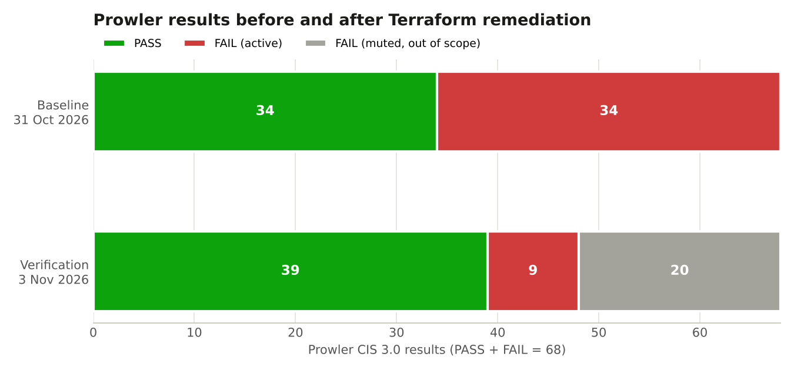
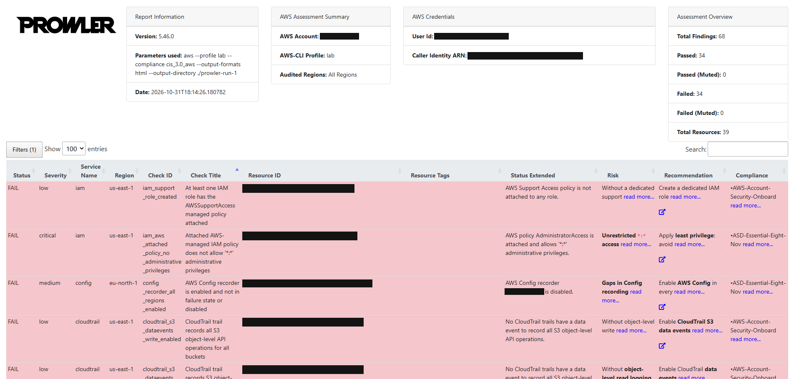
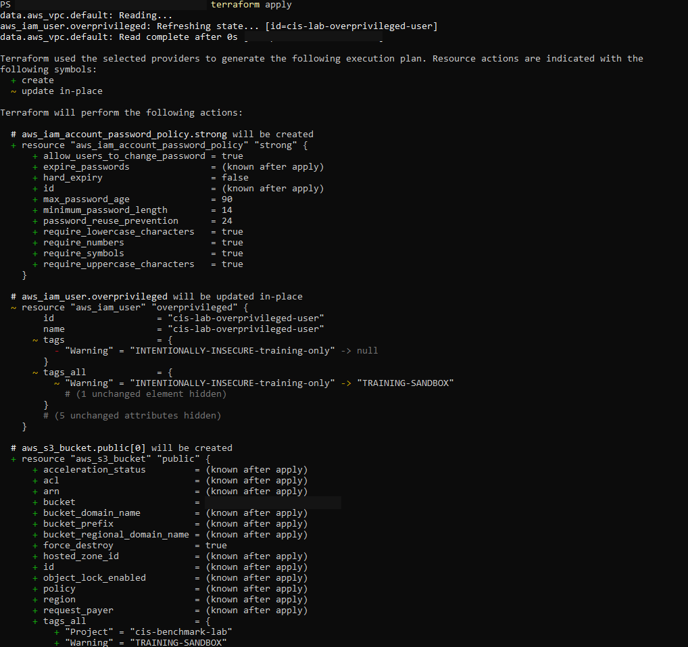
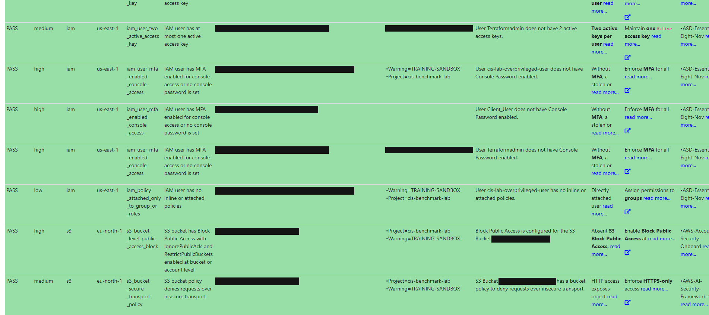
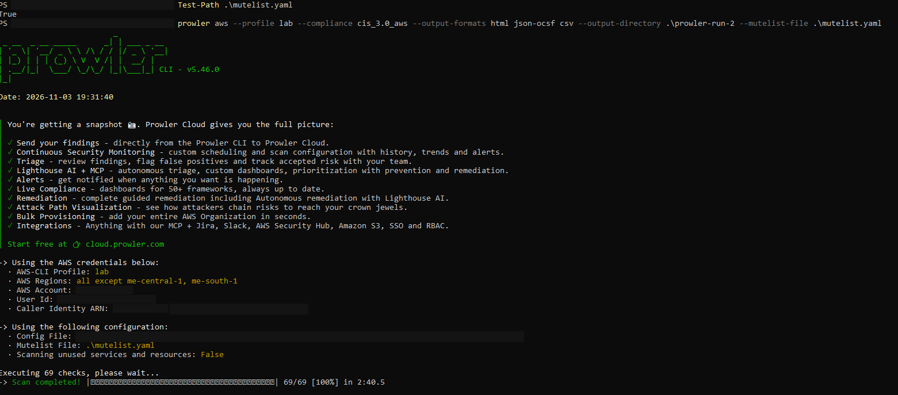
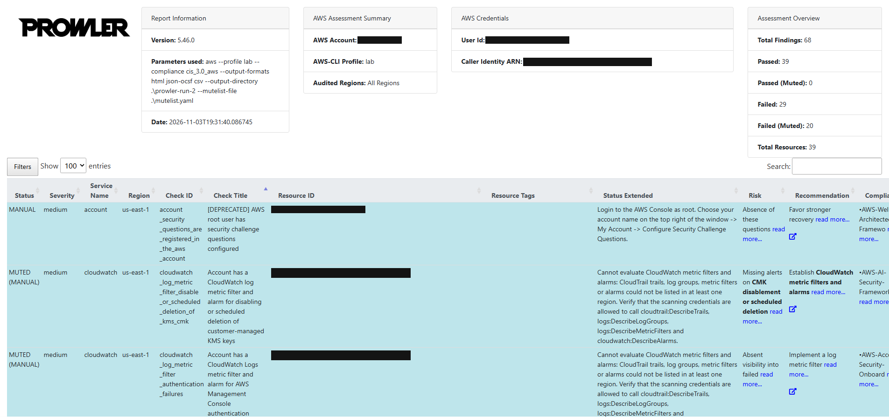
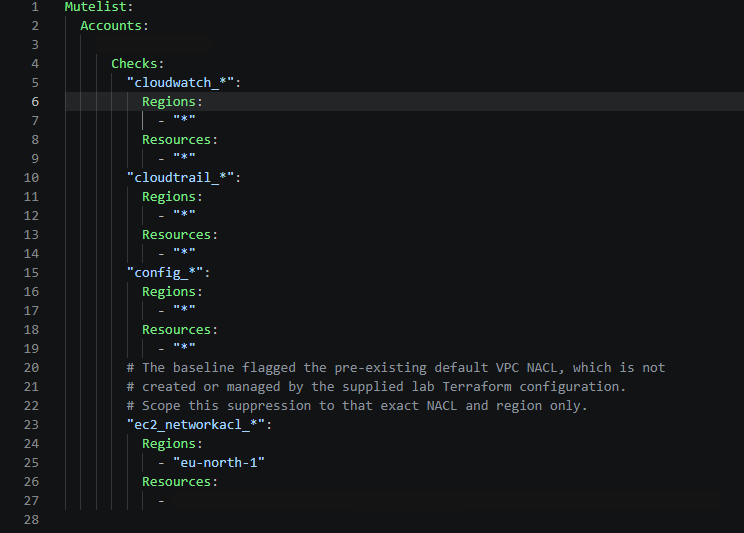

# AWS Cloud Security Posture Assessment — CIS Benchmark v3.0


> Baseline → triage → Terraform remediation → verification scan, against the CIS AWS Foundations Benchmark v3.0 in a dedicated AWS sandbox.

**Scenario:** VaultBridge Financial is an anonymised fintech that runs digital wallet and payment-settlement services on AWS. It had no security baseline and no visibility of its posture. My task was to measure the account against a recognised benchmark, triage the findings by practical risk, fix a selected set with Infrastructure as Code, and prove the change with a repeat scan.

---

## Results at a glance



| Metric | Baseline (31 Oct) | Verification (3 Nov) | Change |
|---|---:|---:|---|
| PASS | 34 | 39 | **+5** |
| FAIL (total) | 34 | 29 | −5 |
| — of which muted (agreed out of scope) | 0 | 20 | +20 |
| — active, unmuted FAIL | 34 | 9 | |
| Resources assessed | 39 | 39 | — |

**How to read this:** five failing checks were fixed and now pass. The drop in *active* failures from 34 to 9 also includes 20 findings that were **muted, not fixed**: 19 CloudTrail checks and 1 AWS Config check, which were deliberately out of scope for this sprint. A muted finding is still a failed control, so I don't count it as a remediation.

Full per-control comparison: [`results/cis-control-comparison.csv`](results/cis-control-comparison.csv)

---

## Scope & rules of engagement

| Item | Detail |
|---|---|
| Environment | One dedicated AWS training sandbox (not production, not shared) |
| Benchmark | CIS AWS Foundations Benchmark v3.0 (`cis_3.0_aws`) |
| Scanner | Prowler 5.46.0, all regions |
| Assessment identity | Dedicated **read-only** IAM user (`ViewOnlyAccess` + `SecurityAudit`) |
| Change identity | Separate Terraform administration identity |
| Areas assessed | IAM, logging & monitoring, networking, S3 storage, encryption |

Using separate identities means the scanner can't change anything it assesses.

---

## Methodology

```
 1. Baseline        Prowler CIS 3.0 scan, all regions, no suppressions
 2. Triage          Review every FAIL / MANUAL, rate practical risk, agree scope
 3. Tuning          Mutelist for agreed out-of-scope services (CloudTrail, Config, CloudWatch)
 4. Remediation     Terraform: IAM password policy, IAM user, S3 hardening, security group
 5. Verification    Same scan, same identity, same Prowler version, mutelist applied
 6. Reporting       Before/after comparison, residual-risk register, follow-ups
```

Scan commands: [`prowler/run-scans.sh`](prowler/run-scans.sh) · Mutelist: [`prowler/mutelist.yaml`](prowler/mutelist.yaml)

---

## Baseline findings (34 FAIL)

| Service | FAIL | What was wrong |
|---|---:|---|
| CloudTrail | 19 | No multi-region trail (17 regional checks) and no S3 object-level data events (2) |
| IAM | 8 | `AdministratorAccess` attached, weak password policy, over-privileged training user, policies attached directly to users, no support role |
| S3 | 3 | Bucket-level Block Public Access off, no MFA Delete, no secure-transport (HTTPS-only) policy |
| EC2 / network | 3 | Default Network ACL allows all inbound traffic from `0.0.0.0/0`, including SSH (22) and RDP (3389) |
| AWS Config | 1 | Recorder disabled in `eu-north-1` |



---

## Remediation (Terraform)

All changes are in [`terraform/main.tf`](terraform/main.tf). The saved plan showed **7 resources to add, 1 to update in place**.

| Control area | Change | Verified result |
|---|---|---|
| IAM password policy | Min length 14; upper, lower, number and symbol required; 90-day max age; 24-password reuse prevention | CIS 1.8 and 1.9 → **PASS** |
| Over-privileged training user | Admin policy and long-lived access key removed; no inline or attached policies | CIS 1.15 (this user) → **PASS** |
| S3 public access | All four bucket-level Block Public Access settings enabled | CIS 2.1.4 → **PASS** |
| S3 transport security | Bucket policy denies any request where `aws:SecureTransport = false` | CIS 2.1.1 → **PASS** |
| S3 data protection | Versioning enabled; default SSE (AES-256) | In the plan; live API evidence still to capture |
| Security group | Lab SG rebuilt with no inbound SSH/RDP from the internet | In the plan; live rule-set evidence still to capture |

Guardrails in the code: `allowed_account_ids` stops the configuration being applied to the wrong AWS account, and the lab user gets no access key at all.




<details>
<summary><b>More evidence: verification scan, summary and mutelist</b></summary>





</details>

---

## Residual risk register (9 active FAIL)

These were documented and **excluded from this remediation sprint** on the engagement manager's direction. They are still real gaps.

| Priority | CIS | Finding | Disposition |
|---|---|---|---|
| **P1** | 1.16 | `AdministratorAccess` attached to the Terraform admin user and a role | Retained as the sandbox admin path. Move to time-bound, role-based admin before any production use |
| **P1** | 5.1 | Default NACL allows all inbound from `0.0.0.0/0` (3 checks) | Pre-existing default VPC NACL; fix in a separate, approved networking change |
| P2 | 2.1.2 | MFA Delete disabled on the lab bucket | Deferred; needs a root + MFA procedure |
| P2 | 1.15 | Read-only scanner policies attached directly to a user (2), admin policy attached directly to a user (1) | Move to an IAM group or role if the project is extended |
| P2 | 1.17 | No IAM role with `AWSSupportAccess` | Not required for the sandbox operating model |

Muted, still failing underneath: 19 CloudTrail, 1 AWS Config, and 15 CloudWatch manual checks. These need their own logging & monitoring workstream.

---

## What I'd do next

- Enable a multi-region CloudTrail with log-file validation, AWS Config in all regions, and CIS 4.x CloudWatch metric filters and alarms
- Replace standing `AdministratorAccess` with assumed roles and short session durations
- Capture live AWS CLI evidence for S3 encryption and versioning, and for the live security-group rules
- Run ScoutSuite as a second opinion against Prowler
- Run Prowler on a schedule (CI) so drift is caught automatically

---

## Repository structure

```
.
├── terraform/
│   ├── main.tf                     # Remediated sandbox configuration
│   └── terraform.tfvars.example    # Placeholder values (real tfvars are git-ignored)
├── prowler/
│   ├── mutelist.yaml               # Suppressions for agreed out-of-scope checks
│   └── run-scans.sh                # Baseline and verification scan commands
├── results/
│   └── cis-control-comparison.csv  # Per-control status, baseline vs verification (sanitised)
└── docs/images/                    # Redacted evidence screenshots
```

## Reproduce

```bash
cd terraform
cp terraform.tfvars.example terraform.tfvars   # set your sandbox account ID and bucket
terraform init && terraform plan -out remediation.tfplan
terraform apply remediation.tfplan

cd ../prowler && ./run-scans.sh
```

> ⚠️ The IAM password policy is **account-wide**. Only apply this configuration in an isolated training account.

---

**Skills shown:** cloud security posture management (CSPM) · CIS benchmarking · risk triage · Infrastructure as Code remediation · evidence-based reporting · scoping and honest residual-risk disclosure

*Account IDs, IAM user IDs, ARNs and resource names have been redacted or replaced with placeholders. Raw Prowler output is not published.*
